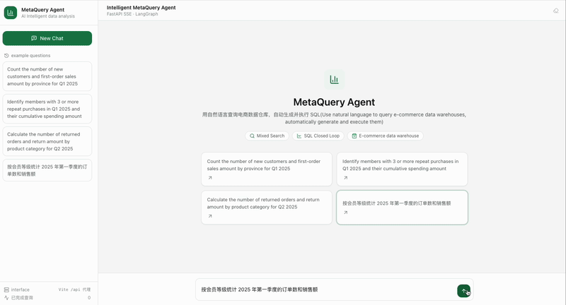
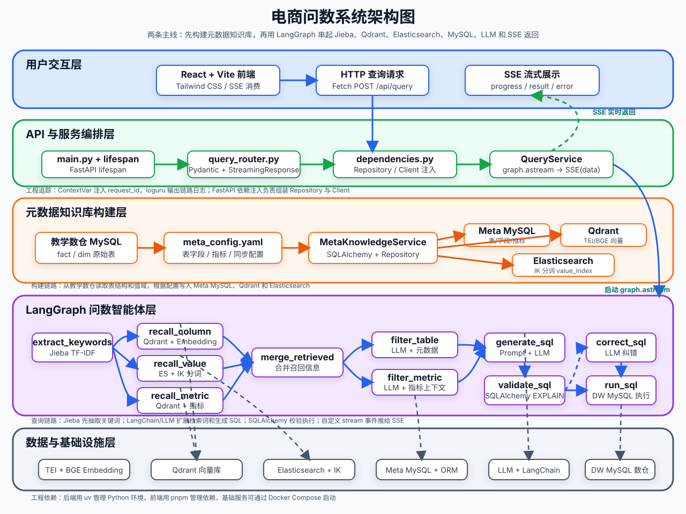

# MetaQuery Agent

**English** | [简体中文](README.zh-CN.md)

> A LangGraph-based conversational analytics system for e-commerce: query the data warehouse in natural language, with automatic semantic retrieval, SQL generation, safety validation, and execution — including multi-turn follow-up questions.

[](https://www.python.org/)
[](https://fastapi.tiangolo.com/)
[](https://langchain-ai.github.io/langgraph/)
[](https://react.dev/)
[](https://www.mysql.com/)
[](https://www.docker.com/)
[](LICENSE)

## Demo



## Features

- **Natural-language querying**: ask "What was last year's revenue per product category nationwide?" — the agent generates SQL, executes it, and returns structured results
- **Multi-route hybrid retrieval**: fields (Qdrant vectors), metrics (Qdrant vectors), and values (Elasticsearch full-text) retrieved in parallel, then filtered and re-ranked by the LLM
- **Closed-loop SQL generation**: generate → EXPLAIN validation → automatic self-correction on failure → execute
- **SQL safety guardrails**: read-only enforcement (sqlglot AST) + keyword blacklist + query timeout + result row limit — see [docs/sql_safety.md](docs/sql_safety.md)
- **Multi-turn follow-ups**: session memory + question rewriting supports contextual follow-ups like "What about last month?" — see [docs/multi_turn_query.md](docs/multi_turn_query.md)
- **SSE streaming feedback**: per-node progress events let the frontend show the live status of the 13-step agent pipeline

## Architecture



Core pipeline (LangGraph):

```
Question rewriting (multi-turn) → Keyword extraction → Field/Metric/Value triple retrieval → Info merging
→ Metric/Table filtering → Context enrichment → SQL generation → SQL validation ⇄ SQL correction → Query execution
```

The metadata knowledge base is declared in `conf/meta_config.yaml` (descriptions and aliases for tables/fields/metrics) and written by the build script into Meta MySQL, the Qdrant vector store, and ES indexes for use by the retrieval pipeline.

## Tech Stack

| Layer | Technology |
|-------|------------|
| Agent orchestration | LangGraph + LangChain |
| API service | FastAPI (SSE streaming responses) |
| LLM | OpenAI-compatible API (configured in `conf/app_config.yaml`) |
| Data warehouse access | SQLAlchemy 2 (async) + asyncmy → MySQL 8 |
| Vector retrieval | Qdrant + BAAI/bge-large-zh-v1.5 (deployed via HuggingFace TEI) |
| Full-text retrieval | Elasticsearch 8 |
| SQL safety | sqlglot AST parsing |
| Frontend | React 19 + TypeScript + Vite 6 + Tailwind CSS 3 |
| Configuration | OmegaConf + python-dotenv |

## Project Structure

```
data-agent/
├── app/
│   ├── agent/          # LangGraph graph definition, 13 nodes, state & context
│   ├── api/            # FastAPI routes, SSE endpoints, dependency injection
│   ├── clients/        # MySQL/Qdrant/ES/Embedding client management
│   ├── conf/           # Config dataclasses & loading
│   ├── core/           # Logging, request context, SQL safety checks
│   ├── entities/       # Metadata entities (table/field/metric/value)
│   ├── models/         # ORM models
│   ├── prompt/         # Prompt loader
│   ├── repositories/   # Repository layer (meta/dw MySQL, Qdrant, ES)
│   ├── scripts/        # Metadata knowledge base build scripts
│   └── services/       # Query service, session storage
├── conf/               # app_config.yaml / meta_config.yaml
├── docker/             # docker-compose (MySQL/ES/Kibana/Qdrant/TEI)
├── frontend/           # React chat frontend (own package.json, managed with pnpm)
├── prompts/            # 8 LLM prompt templates
├── tests/              # pytest unit tests (45)
└── docs/               # Feature docs (SQL safety, multi-turn queries)
```

## 🚀 Getting Started

The repository ships with a local development environment you can start directly. Follow the steps below in order.

### 1. Prerequisites

- Python >= 3.14
- [uv](https://docs.astral.sh/uv/)
- Docker & Docker Compose
- Node.js & pnpm

### 2. Clone the project

```bash
git clone https://github.com/BODYsuperman/MetaQueryAgent.git
cd project directory
```

### 3. Install backend dependencies

```bash
uv sync
```

### 4. Configure the LLM API key

```bash
cp .env.example .env
```

Replace `LLM_API_KEY` in `.env` with your real key:

```bash
LLM_API_KEY=your_real_api_key
```

The LLM is accessed through an OpenAI-compatible API, configured in `conf/app_config.yaml`:

```yaml
llm:
  model_name: <model name>
  api_key: ${oc.env:LLM_API_KEY}
  base_url: <OpenAI-compatible API base URL>
```

To switch to another OpenAI-compatible model platform, just change `model_name` and `base_url`. Database connections and other settings also live in `conf/app_config.yaml`.

### 5. Prepare the embedding model

The project serves BAAI/bge-large-zh-v1.5 via TEI. The model files are too large to commit to the repository, so download them into the Docker mount directory first:

```bash
uv run hf download BAAI/bge-large-zh-v1.5 --local-dir docker/embedding/bge-large-zh-v1.5
```

If you download manually, extract the files into `docker/embedding/bge-large-zh-v1.5`.

### 6. Start the Docker infrastructure

```bash
docker compose -f docker/docker-compose.yaml up -d
```

Default ports:

| Service | Port |
|---------|------|
| MySQL | 3306 |
| Elasticsearch | 9200 |
| Kibana | 5601 |
| Qdrant | 6333 |
| Embedding (TEI) | 8081 |

`docker/mysql/meta.sql` and `docker/mysql/dw.sql` automatically initialize the metadata database and the demo data warehouse on the MySQL container's first start.

### 7. Build the metadata knowledge base

```bash
uv run python -m app.scripts.build_meta_knowledge -c conf/meta_config.yaml
```

This writes table/field metadata into MySQL, field and metric vectors into Qdrant, and real field values into Elasticsearch.

### 8. Start the backend

```bash
uv run fastapi dev main.py
```

The backend endpoint is `POST http://127.0.0.1:8000/api/query` — see the [API](#api) section below.

### 9. Start the frontend

```bash
cd frontend
pnpm install
pnpm dev
```

Open http://localhost:5173 — the Vite dev proxy forwards `/api` to http://127.0.0.1:8000 by default. To change it:

```bash
cd frontend
cp .env.example .env
```

then edit `VITE_DEV_PROXY_TARGET` in `.env`.

## API

### `POST /api/query`

Request body:

```json
{"query": "What was last year's revenue per product category nationwide?", "session_id": "optional, pass back for follow-ups"}
```

The response is an SSE stream with the following event types:

| Event | Description |
|-------|-------------|
| `{"type":"session","session_id":"..."}` | First event, delivers the session id (pass it back on follow-ups to enable multi-turn context) |
| `{"type":"progress","step":"...","status":"running/success/error"}` | Per-node execution progress |
| `{"type":"result","data":[...]}` | Query result (list of dicts) |
| `{"type":"error","message":"..."}` | Error message |

## Testing

```bash
uv run pytest -v
```

Covers SQL safety checks (read-only/blacklist/timeout/row limit), session storage, the question-rewriting node, the repository layer, and the API contract — 45 tests in total.


## License

This project is licensed under the [MIT License](LICENSE).
