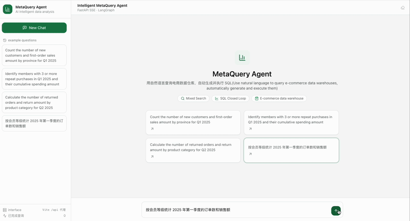
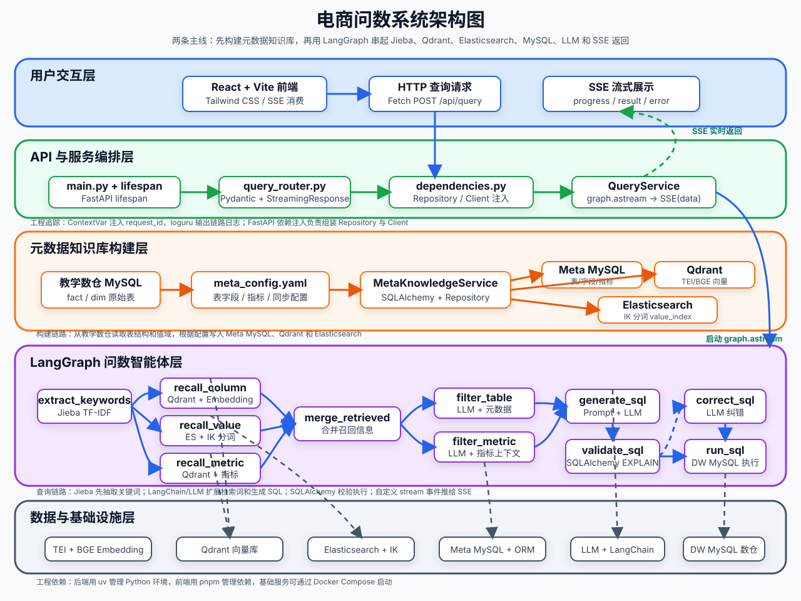

# MetaQuery Agent（掌柜问数）

[English](README.md) | **简体中文**

> 基于 LangGraph 的电商智能问数系统：用自然语言查询数据仓库，自动完成语义检索、SQL 生成、安全校验与执行，支持多轮追问。

[](https://www.python.org/)
[](https://fastapi.tiangolo.com/)
[](https://langchain-ai.github.io/langgraph/)
[](https://react.dev/)
[](https://www.mysql.com/)
[](https://www.docker.com/)
[](LICENSE)

## 效果演示



## 功能特性

- **自然语言问数**：输入"统计全国各分类商品去年卖了多少钱？"，自动生成 SQL、执行并返回结构化结果
- **多路混合召回**：字段（Qdrant 向量）、指标（Qdrant 向量）、取值（Elasticsearch 全文）三路并行检索，LLM 过滤精排
- **SQL 生成闭环**：生成 → EXPLAIN 校验 → 失败自动纠错 → 执行
- **SQL 安全防护**：只读限制（sqlglot AST）+ 黑名单关键字 + 查询超时 + 结果行数限制，详见 [docs/sql_safety.md](docs/sql_safety.md)
- **多轮追问**：会话记忆 + 问题改写，支持"那上个月呢？"这类上下文追问，详见 [docs/multi_turn_query.md](docs/multi_turn_query.md)
- **SSE 流式反馈**：逐节点推送执行进度，前端实时展示 13 步 Agent 流程状态

## 系统架构



核心链路（LangGraph）：

```
问题改写(多轮) → 关键词抽取 → 字段/指标/取值三路召回 → 信息合并
→ 指标/表过滤 → 补充上下文 → 生成 SQL → 校验 SQL ⇄ 校正 SQL → 执行查询
```

元数据知识库由 `conf/meta_config.yaml` 声明（表/字段/指标的描述与别名），
通过构建脚本写入 Meta MySQL、Qdrant 向量库与 ES 索引，供检索链路使用。

## 技术栈

| 层 | 技术 |
|----|------|
| Agent 编排 | LangGraph + LangChain |
| API 服务 | FastAPI（SSE 流式响应） |
| LLM | OpenAI 兼容接口（`conf/app_config.yaml` 配置） |
| 数据仓储 | SQLAlchemy 2 (async) + asyncmy → MySQL 8 |
| 向量检索 | Qdrant + BAAI/bge-large-zh-v1.5（HuggingFace TEI 部署） |
| 全文检索 | Elasticsearch 8 |
| SQL 安全 | sqlglot AST 解析 |
| 前端 | React 19 + TypeScript + Vite 6 + Tailwind CSS 3 |
| 配置管理 | OmegaConf + python-dotenv |

## 项目结构

```
data-agent/
├── app/
│   ├── agent/          # LangGraph 图定义、13 个节点、状态与上下文
│   ├── api/            # FastAPI 路由、SSE 接口、依赖注入
│   ├── clients/        # MySQL/Qdrant/ES/Embedding 客户端管理
│   ├── conf/           # 配置 dataclass 与加载
│   ├── core/           # 日志、请求上下文、SQL 安全检查
│   ├── entities/       # 元数据实体（表/字段/指标/取值）
│   ├── models/         # ORM 模型
│   ├── prompt/         # 提示词加载器
│   ├── repositories/   # 仓储层（meta/dw MySQL、Qdrant、ES）
│   ├── scripts/        # 元数据知识库构建脚本
│   └── services/       # 查询服务、会话存储
├── conf/               # app_config.yaml / meta_config.yaml
├── docker/             # docker-compose（MySQL/ES/Kibana/Qdrant/TEI）
├── frontend/           # React 聊天前端（独立 package.json，pnpm 管理）
├── prompts/            # 8 个 LLM 提示词模板
├── tests/              # pytest 单元测试（45 个）
└── docs/               # 功能文档（SQL 安全、多轮问数）
```

## 🚀 快速开始

当前仓库已经包含一套可直接启动的本地开发环境，按照以下顺序启动项目。

### 1. 准备环境

- Python >= 3.14
- [uv](https://docs.astral.sh/uv/)
- Docker 与 Docker Compose
- Node.js 与 pnpm

### 2. 克隆项目

```bash
git clone https://github.com/BODYsuperman/MetaQueryAgent.git
cd project directory
```

### 3. 安装后端依赖

```bash
uv sync
```

### 4. 配置大模型 API Key

```bash
cp .env.example .env
```

把 `.env` 中的 `LLM_API_KEY` 替换成真实密钥：

```bash
LLM_API_KEY=your_real_api_key
```

LLM 通过 OpenAI 兼容接口接入，在 `conf/app_config.yaml` 中配置：

```yaml
llm:
  model_name: <模型名称>
  api_key: ${oc.env:LLM_API_KEY}
  base_url: <OpenAI 兼容 API 地址>
```

如需切换其他兼容 OpenAI API 的模型平台，修改 `model_name` 和 `base_url` 即可。
数据库连接等其余配置同样见 `conf/app_config.yaml`。

### 5. 准备 Embedding 模型

项目通过 TEI 加载 BAAI/bge-large-zh-v1.5。模型文件体积较大，无法在仓库中提交，
需要先下载到 Docker 挂载目录：

```bash
uv run hf download BAAI/bge-large-zh-v1.5 --local-dir docker/embedding/bge-large-zh-v1.5
```

如果手动下载，请解压到 `docker/embedding/bge-large-zh-v1.5` 路径下。

### 6. 启动 Docker 基础服务

```bash
docker compose -f docker/docker-compose.yaml up -d
```

默认端口：

| 服务 | 端口 |
|------|------|
| MySQL | 3306 |
| Elasticsearch | 9200 |
| Kibana | 5601 |
| Qdrant | 6333 |
| Embedding (TEI) | 8081 |

`docker/mysql/meta.sql` 和 `docker/mysql/dw.sql` 会在 MySQL 容器首次启动时
自动初始化元数据库和教学数仓。

### 7. 构建元数据知识库

```bash
uv run python -m app.scripts.build_meta_knowledge -c conf/meta_config.yaml
```

这一步会把表字段元数据写入 MySQL，把字段和指标向量写入 Qdrant，
并把字段真实取值写入 Elasticsearch。

### 8. 启动后端

```bash
uv run fastapi dev main.py
```

后端接口为 `POST http://127.0.0.1:8000/api/query`，详见下方 [API](#api) 章节。

### 9. 启动前端

```bash
cd frontend
pnpm install
pnpm dev
```

访问 http://localhost:5173 ，Vite 开发代理默认把 `/api` 转发到 http://127.0.0.1:8000 。
如需修改：

```bash
cd frontend
cp .env.example .env
```

然后编辑 `.env` 中的 `VITE_DEV_PROXY_TARGET`。

## API

### `POST /api/query`

请求体：

```json
{"query": "统计全国各分类商品去年卖了多少钱？", "session_id": "可选，追问时回传"}
```

响应为 SSE 流，事件类型：

| 事件 | 说明 |
|------|------|
| `{"type":"session","session_id":"..."}` | 首事件，下发会话 id（追问时回传以启用多轮上下文） |
| `{"type":"progress","step":"...","status":"running/success/error"}` | 各节点执行进度 |
| `{"type":"result","data":[...]}` | 查询结果（字典列表） |
| `{"type":"error","message":"..."}` | 错误信息 |

## 测试

```bash
uv run pytest -v
```

覆盖 SQL 安全检查（只读/黑名单/超时/行数）、会话存储、问题改写节点、
仓储层与 API 契约，共 45 个用例。


## License

本项目基于 [MIT License](LICENSE) 开源。
